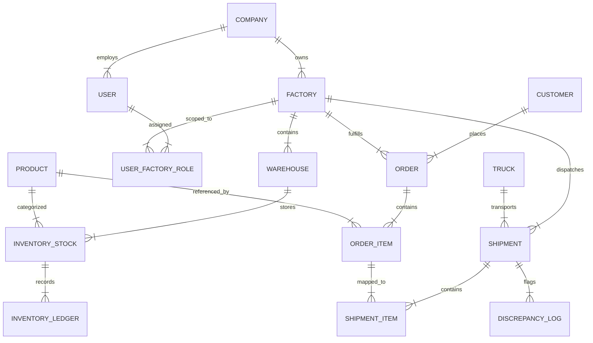

# Ordexa — System Architecture Document (SAD)

## 1. High-Level Architecture Pattern: Modular Monolith

Ordexa uses a **Modular Monolith** architecture pattern. All backend modules run inside a unified Java 21 / Spring Boot 3 application process with strictly enforced module boundaries. This guarantees high developer velocity, single-deployment simplicity, and ACID transactions across domain modules, while keeping code isolated for potential future microservice extraction.

```
+-------------------------------------------------------------------+
|                        Ordexa Mobile (Android)                    |
|          Kotlin + Jetpack Compose + CameraX + Retrofit            |
+-------------------------------------------------------------------+
                                  |
                                  | REST API (HTTPS / JSON)
                                  v
+-------------------------------------------------------------------+
|                     Ordexa Backend (Spring Boot 3)                |
|                                                                   |
|  +---------------+  +---------------+  +-----------------------+  |
|  | Security & Auth|  | Factory & Org |  | Order Management      |  |
|  | Module (JWT)  |  | Module        |  | Module (PDF/State)    |  |
|  +---------------+  +---------------+  +-----------------------+  |
|  +---------------+  +---------------+  +-----------------------+  |
|  | Inventory     |  | Dispatch &    |  | AI Assistant          |  |
|  | Ledger Module |  | Logistics     |  | Module (Tool Calling) |  |
|  +---------------+  +---------------+  +-----------------------+  |
+-------------------------------------------------------------------+
                                  |
               +------------------+------------------+
               |                                     |
               v                                     v
   +-----------------------+             +-----------------------+
   | PostgreSQL Database   |             | LLM / Document OCR    |
   | (Flyway Migrations)   |             | Service API           |
   +-----------------------+             +-----------------------+
```

---

## 2. Technology Stack Definition

| Layer | Selection | Rationale |
| :--- | :--- | :--- |
| **Mobile Client** | Kotlin 2.0+, Jetpack Compose, Material 3 | Modern declarative UI, robust Android SDK integration |
| **Mobile Camera / Scanning** | CameraX + Google ML Kit Barcode Scanning | High performance 1D/2D barcode recognition on Android |
| **Mobile Networking** | Retrofit 2 + OkHttp 4 + Kotlinx Serialization | Industry standard HTTP client with token refresh interceptors |
| **Backend Runtime** | Java 21 LTS | High performance, Virtual Threads (Project Loom), LTS stability |
| **Backend Framework** | Spring Boot 3.x, Spring Security 6 | Enterprise standard, robust security filters, DI engine |
| **Relational Database** | PostgreSQL 16+ | Powerful JSONB support, ACID compliance, robust transaction locking |
| **Schema Migration** | Flyway | Versioned SQL scripts, reproducible database setup |
| **Containerization** | Docker + Docker Compose | Consistent local dev & production deployment |
| **AI Integration** | Spring AI / Controlled Tool Calling | Deterministic database tool execution with natural language UI |

---

## 3. Database Domain Model & ER Architecture



---

## 4. Key Database Schema Definitions

### 4.1 `orders` & `order_items`
```sql
CREATE TABLE orders (
    id UUID PRIMARY KEY DEFAULT gen_random_uuid(),
    company_id UUID NOT NULL REFERENCES companies(id),
    factory_id UUID NOT NULL REFERENCES factories(id),
    customer_id UUID NOT NULL REFERENCES customers(id),
    external_po_number VARCHAR(100) NOT NULL,
    order_date DATE NOT NULL,
    requested_delivery_date DATE,
    priority VARCHAR(20) DEFAULT 'NORMAL',
    status VARCHAR(30) NOT NULL DEFAULT 'DRAFT', -- DRAFT, VERIFIED, APPROVED, RESERVED, PARTIALLY_DISPATCHED, COMPLETED, CANCELLED
    ship_to_address TEXT,
    bill_to_address TEXT,
    subtotal NUMERIC(12,2) NOT NULL,
    gst_amount NUMERIC(12,2) NOT NULL,
    total_amount NUMERIC(12,2) NOT NULL,
    created_at TIMESTAMP WITH TIME ZONE DEFAULT CURRENT_TIMESTAMP,
    CONSTRAINT uq_po_per_customer UNIQUE (company_id, customer_id, external_po_number)
);

CREATE TABLE order_items (
    id UUID PRIMARY KEY DEFAULT gen_random_uuid(),
    order_id UUID NOT NULL REFERENCES orders(id) ON DELETE CASCADE,
    product_id UUID NOT NULL REFERENCES products(id),
    sku VARCHAR(50) NOT NULL,
    description TEXT,
    uom VARCHAR(20) NOT NULL DEFAULT 'PCS',
    quantity INT NOT NULL,
    unit_price NUMERIC(10,2) NOT NULL,
    total_amount NUMERIC(12,2) NOT NULL
);
```

### 4.2 `inventory_stock` & `inventory_ledger`
```sql
CREATE TABLE inventory_stock (
    id UUID PRIMARY KEY DEFAULT gen_random_uuid(),
    warehouse_id UUID NOT NULL REFERENCES warehouses(id),
    product_id UUID NOT NULL REFERENCES products(id),
    sku VARCHAR(50) NOT NULL,
    physical_qty INT NOT NULL DEFAULT 0,
    reserved_qty INT NOT NULL DEFAULT 0,
    version BIGINT NOT NULL DEFAULT 0, -- Optimistic locking
    CONSTRAINT uq_warehouse_product UNIQUE (warehouse_id, product_id)
);

CREATE TABLE inventory_ledger (
    id UUID PRIMARY KEY DEFAULT gen_random_uuid(),
    inventory_stock_id UUID NOT NULL REFERENCES inventory_stock(id),
    transaction_type VARCHAR(30) NOT NULL, -- RECEIPT, RESERVATION, PICK, DISPATCH, DAMAGE, ADJUSTMENT
    reference_type VARCHAR(30) NOT NULL,   -- GRN, ORDER, SHIPMENT, DAMAGE_REPORT, AUDIT
    reference_id VARCHAR(100) NOT NULL,    -- e.g., GRN-778, ORD-1001, SHP-2001, DMG-004
    qty_in INT NOT NULL DEFAULT 0,
    qty_out INT NOT NULL DEFAULT 0,
    balance_after INT NOT NULL,
    performed_by UUID NOT NULL REFERENCES users(id),
    approved_by UUID REFERENCES users(id),
    notes TEXT,
    created_at TIMESTAMP WITH TIME ZONE DEFAULT CURRENT_TIMESTAMP
);
```

### 4.3 `trucks`, `shipments`, and `discrepancy_logs`
```sql
CREATE TABLE trucks (
    id UUID PRIMARY KEY DEFAULT gen_random_uuid(),
    factory_id UUID NOT NULL REFERENCES factories(id),
    vehicle_number VARCHAR(50) NOT NULL,
    driver_name VARCHAR(100) NOT NULL,
    driver_phone VARCHAR(20),
    capacity_weight_kg NUMERIC(10,2),
    route_name VARCHAR(100) NOT NULL,
    status VARCHAR(30) NOT NULL DEFAULT 'AVAILABLE' -- AVAILABLE, ASSIGNED, IN_TRANSIT, MAINTENANCE
);

CREATE TABLE shipments (
    id UUID PRIMARY KEY DEFAULT gen_random_uuid(),
    factory_id UUID NOT NULL REFERENCES factories(id),
    truck_id UUID REFERENCES trucks(id),
    shipment_number VARCHAR(50) NOT NULL UNIQUE,
    destination_city VARCHAR(100) NOT NULL,
    status VARCHAR(30) NOT NULL DEFAULT 'DRAFT', -- DRAFT, READY_FOR_ASSIGNMENT, ASSIGNED, LOADING, LOADED, VERIFIED, DISPATCH_APPROVED, DISPATCHED, DELIVERED, ON_HOLD, EXCEPTION_REVIEW
    created_by UUID NOT NULL REFERENCES users(id),
    approved_by UUID REFERENCES users(id),
    created_at TIMESTAMP WITH TIME ZONE DEFAULT CURRENT_TIMESTAMP
);

CREATE TABLE discrepancy_logs (
    id UUID PRIMARY KEY DEFAULT gen_random_uuid(),
    shipment_id UUID REFERENCES shipments(id),
    order_id UUID REFERENCES orders(id),
    discrepancy_type VARCHAR(50) NOT NULL, -- DESTINATION_MISMATCH, EXTRA_QUANTITY, WRONG_SKU, DUPLICATE_PO
    expected_value TEXT NOT NULL,
    observed_value TEXT NOT NULL,
    detected_at_stage VARCHAR(50) NOT NULL,
    resolution_status VARCHAR(30) NOT NULL DEFAULT 'OPEN', -- OPEN, RESOLVED, REJECTED
    exception_reason TEXT,
    approved_by UUID REFERENCES users(id),
    created_at TIMESTAMP WITH TIME ZONE DEFAULT CURRENT_TIMESTAMP
);
```

---

## 5. Multi-Factory Data Isolation & Locking Strategy

1. **Security Isolation**: Every JWT contains `company_id`, `role`, and `permitted_factory_ids`. Spring Security `FactorySecurityInterceptor` sets ThreadLocal context; JPA repositories auto-append `WHERE factory_id = :factoryId`.
2. **Stock Concurrency Locking**:
   - Stock reservations and ledger dispatches acquire a pessimistic lock (`SELECT ... FOR UPDATE` on `inventory_stock`) or rely on Hibernate optimistic locking (`@Version`).
   - `Available Qty` check is evaluated inside the DB transaction:
     ```sql
     SELECT (physical_qty - reserved_qty) FROM inventory_stock WHERE id = :stockId FOR UPDATE;
     ```

---

## 6. Android Client Architecture

```
[ UI Layer (Compose Screens + Material 3) ]
                    |
                    v
[ ViewModel Layer (UI State + StateFlow) ]
                    |
                    v
[ Repository Layer (Single Source of Truth) ]
          /                   \
         v                     v
[ Local DB (Room) ]    [ Remote API (Retrofit) ]
```

### Android Module Directory Layout
```
com.example.ordexa/
├── data/
│   ├── remote/        # Retrofit APIs, DTOs, Auth Interceptor
│   ├── local/         # Room DB, Entities, DAOs (Offline support)
│   └── repository/    # OrderRepository, InventoryRepository, DispatchRepository
├── ui/
│   ├── components/    # Common UI elements (Buttons, Inputs, BarcodeScanner)
│   ├── theme/         # Color, Type, Theme definitions
│   └── screens/
│       ├── auth/      # Login, Factory Selection
│       ├── order/     # Order List, Upload PDF, Detail
│       ├── inventory/ # Stock Ledger, Receive, Adjust
│       └── dispatch/  # Shipment, Truck Loading, Scanner
├── domain/            # Models, UseCases, Validation Logic
└── util/              # Formatters, Constants, Permissions
```
